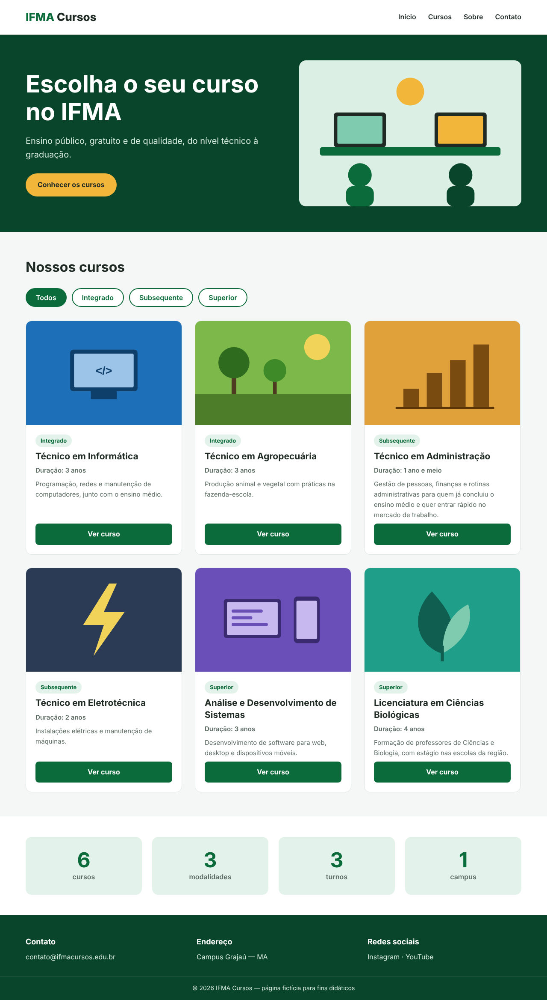
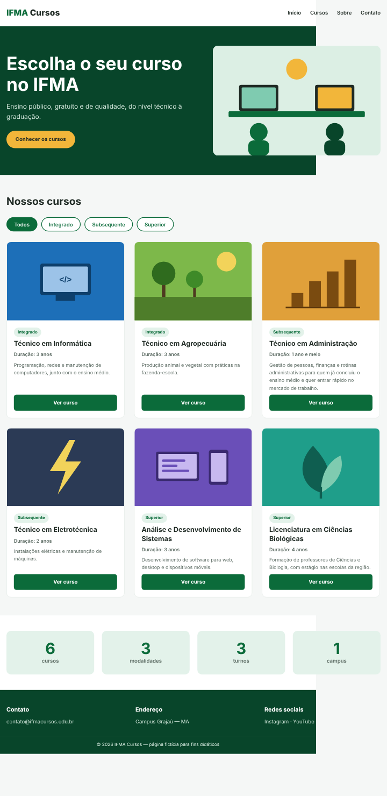
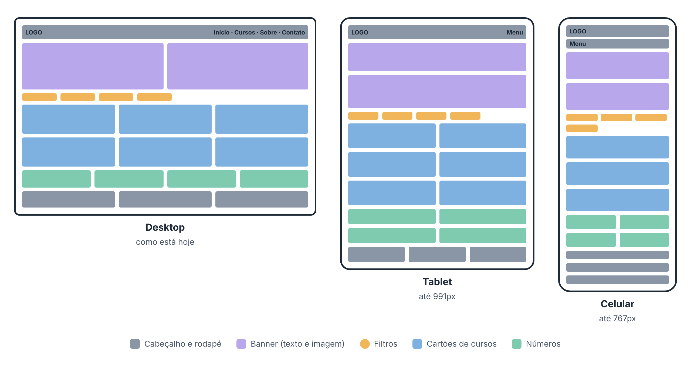

# Portal de Cursos — Desafio de Responsividade

Desafio prático da disciplina **Programação Web I** (Tecnologia em Análise e Desenvolvimento de Sistemas — IFMA Campus Grajaú).

Este repositório contém o **IFMA Cursos**, um portal fictício de cursos que foi feito **apenas para telas de computador**. No desktop, tudo funciona. No celular, a página quebra inteira.

**Sua missão: deixar a página responsiva, usando apenas CSS.**

| Como está no desktop | Como está no celular |
|---|---|
|  |  |

---

## Como começar

1. Faça um **fork** deste repositório e clone o seu fork, ou baixe o projeto em **Code → Download ZIP**.
2. Abra o `index.html` no navegador.
3. Ative o modo dispositivo: **F12** e depois **Ctrl + Shift + M** (Chrome e Edge).
4. Compare a página em um desktop e em um celular.

```
portal-cursos/
├── index.html
├── style.css      ← todo o seu trabalho é aqui
├── img/
│   ├── banner.svg
│   └── curso1.svg ... curso6.svg
└── docs/          ← imagens deste README
```

---

## Etapa 1 — Encontre os 6 problemas escondidos

Antes de escrever qualquer media query, o código tem **6 problemas** que impedem a página de ser responsiva. Abaixo estão os sintomas. Encontre a causa de cada um no código e corrija.

| # | Sintoma |
|---|---|
| 1 | No celular, a página aparece toda encolhida e o texto fica minúsculo. |
| 2 | A página inteira é mais larga que a tela, e aparece rolagem horizontal. |
| 3 | A imagem do banner não diminui e passa da tela. |
| 4 | Os botões de filtro não quebram linha e saem da tela. |
| 5 | Os cartões dos cursos não se ajustam ao espaço disponível. |
| 6 | Os tamanhos de texto estão em `px` e não acompanham as preferências do usuário. |

> **Dica:** use o inspetor do navegador para descobrir qual elemento está mais largo que a tela.

---

## Etapa 2 — Torne a página responsiva

Use a abordagem **desktop-first**: o CSS que já existe é o do desktop, e você acrescenta media queries com `max-width` para as telas menores.

### O layout esperado



### O que muda até 991px

`@media (max-width: 991px)`

- **Banner:** texto em cima, imagem embaixo; título um pouco menor.
- **Cursos:** 2 colunas, com os botões continuando alinhados na base.
- **Números:** 2 colunas, em duas linhas.
- Cabeçalho, filtros e rodapé continuam como no desktop.

### O que muda até 767px

`@media (max-width: 767px)`

- **Cabeçalho:** menu abaixo do logo, com os links quebrando linha.
- **Filtros:** botões quebrando linha, sem sair da tela.
- **Cursos:** 1 coluna, cartões ocupando a largura toda.
- **Rodapé:** contato, endereço e redes empilhados.

---

## Regras

- [ ] Não altere o `<body>` do HTML; mexa só no `<head>`, se precisar.
- [ ] Desktop-first: o CSS que já existe é o do desktop.
- [ ] Apenas duas media queries: `max-width: 991px` e `max-width: 767px`.
- [ ] Fontes em `rem`.
- [ ] Nenhuma largura fixa em `px` nos blocos grandes da página.
- [ ] O desktop precisa continuar igual ao original.
- [ ] Sem frameworks e sem JavaScript.

---

## Antes de entregar

Teste cada largura no modo dispositivo do navegador:

| Largura | O que deve acontecer |
|---|---|
| 1280px | igual ao original |
| 991px | banner empilhado, cursos e números em 2 colunas |
| 767px | menu abaixo do logo, cursos em 1 coluna, rodapé empilhado |
| 320px | nada sai da tela e não há rolagem horizontal |


